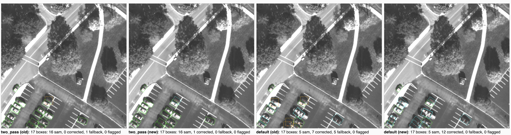

# Copyright Statement

Copyright 2026, by the California Institute of Technology. ALL RIGHTS RESERVED. United States Government Sponsorship acknowledged. Any commercial use must be negotiated with the Office of Technology Transfer at the California Institute of Technology.
 
This software may be subject to U.S. export control laws. By accepting this software, the user agrees to comply with all applicable U.S. export laws and regulations. User has the responsibility to obtain export licenses, or other export authority as may be required before exporting such information to foreign countries or providing access to foreign persons.

# About
Label Refiner & Small Object Detection Tools

This repository turns point labels of small objects (vehicles) in aerial imagery (COWC, VEDAI and similar) into YOLO-style Oriented Bounding Box (OBB) labels. Each labeled point is used as a prompt for the Segment Anything Model (SAM), the resulting mask becomes a rotated box, and size checks catch bad masks. Ideas from Personalized SAM (PerSAM) supply a "how car-like is this point" score, used for review flags.

There are three ways through the code:
- **Option 0** (`scripts/refine_labels.py`): the main path. Works on any dataset of point labels and has command-line options. On VEDAI, settings are scored against the true boxes, with a holdout set (see "Tuning on VEDAI").
- **Option A** (VEDAI study) and **Option B** (COWC): the original pipelines. Their refinement steps are superseded by Option 0, but their data preparation (both) and sensor degradation and validation (B) are still used.

# Directory

```
label-refiner/
├── README.md
├── requirements.txt
├── ref_car.png                     <-- COWC reference car crop (a ~30 px car enlarged 10x)
├── models/                         <-- model weights, not in git (see models/README.md)
│   ├── sam_vit_b.pth
│   ├── dinov2-main/                    (only for --features dino)
│   └── dinov2_vits14_pretrain.pth      (only for --features dino)
├── data/                           <-- raw datasets (download, see "Get the datasets")
│   ├── COWC/
│   └── VEDAI/
├── datasets/                       <-- point-label datasets made from data/
│   ├── COWC_Points_512/                {train,val,test}/{images,labels}, ref_car.png
│   └── vedai_512/                      vedai_color_centerpoint/ (input), vedai_color_obb/ (truth)
├── datasets_refined/               <-- refined OBB datasets (default output)
├── scripts/
│   ├── refine_labels.py                    <-- Option 0: point labels -> OBB labels
│   ├── evaluate_updated_vedai_labels.py    <-- Option 0: score a run against VEDAI's true boxes
│   ├── make_cowc_subset.py                 <-- rebuild the COWC mini dataset
│   ├── make_vedai_subset.py                <-- build VEDAI test sets (mini, tune, holdout, jittered)
│   ├── run_vedai_sweep.sh                  <-- run a list of settings on a VEDAI test set
│   ├── run_vedai_jitter_overnight.sh       <-- the sweep on the whole tune split, exact and jittered points
│   ├── summarize_vedai_sweep.py            <-- sweep table + comparison page
│   ├── 00pure_geographic_splitter.py       <-- COWC: tile into 512 px patches with geographic splits
│   ├── 01cowc_persam_generate_dataset.py   <-- Option B refinement (older)
│   ├── 02sensor_degradation.py             <-- Option B: degraded copy of the dataset
│   ├── VS_VEDAI_Separation_Conversion.py   <-- VEDAI: convert to point labels + true OBBs
│   ├── VS_PerSAM_DINOv2.py                 <-- Option A refinement (superseded)
│   └── VS_evaluate_pipeline.py             <-- Option A evaluation (superseded)
├── data_exploration/
│   ├── plot_obb_labels.py                  <-- draw boxes over images
│   ├── compare_plots_html.py               <-- side-by-side comparison page of several runs
│   ├── vehicle_crops_html.py               <-- zoomed per-vehicle crops, one column per run
│   └── val_yolo_dataset.py                 <-- interactive dataset inspector
├── COWC_mini_test/                 <-- COWC mini dataset (image_list.txt; rebuild with make_cowc_subset.py)
├── VEDAI_mini_test/                <-- VEDAI 12-image quick-check set (image_list.txt, sweep_summary.txt)
├── VEDAI_tune*/, VEDAI_holdout*/   <-- VEDAI tune split / holdout sets (only sweep_summary.txt is in git)
└── Personalize-SAM/                <-- copy of the PerSAM project, for reference (not imported)
```

Folders named `*dataset*`, `data/`, `datasets/`, model weights (`*.pth`) and the generated contents of the test-set folders are git-ignored. The test sets are rebuilt from checked-in image lists (see below).

# Setup

## 1. Install Miniforge3 (Conda)
If you don't have Conda yet, on macOS with Homebrew:
```bash
brew install miniforge
conda init "$(basename "$SHELL")"
# then close and reopen your terminal
```
On Linux, download the Miniforge3 installer from https://github.com/conda-forge/miniforge and run it.

## 2. Clone the repository
```bash
git clone https://github.jpl.nasa.gov/science-team-algorithms/label-refiner.git
cd label-refiner
```

## 3. Create and activate the Conda environment
```bash
conda create -n label-refiner python=3.10 -y
conda activate label-refiner
pip install -r requirements.txt
```
If you get Anaconda license errors, use only the conda-forge channel (no `defaults` or `anaconda`). Your `~/.condarc` should look something like:
```yaml
ssl_verify: true
channels:
  - conda-forge
env_prompt: ({name})
channel_priority: strict
```

## 4. Get the model weights
Download `sam_vit_b.pth` (and, for `--features dino`, `dinov2-main/` and `dinov2_vits14_pretrain.pth`) from the Science Team Google Drive into `models/`; see `models/README.md`:
https://drive.google.com/drive/folders/1FTX76Ybf0PLiqdwyKsCvyi2WsF-ccoxY

On analysis.jpl.nasa.gov CUDA is unusable (driver too old), so SAM runs on CPU at about 3 s per 512 px image.

# Get the datasets

Download the COWC and VEDAI raw data from Google Drive (the `COWC_RAW` and `VEDAI_RAW` folders): https://drive.google.com/drive/folders/1VMFEMDJFNktTk5jbTBxdbuE9ii9rSwxf

Put them under `data/` in the repository and unpack them:
```bash
mkdir -p data
cd data

# COWC: COWC.zip from the COWC_RAW folder
unzip COWC.zip

# VEDAI: the VEDAI_RAW folder
mv VEDAI_RAW VEDAI
cd VEDAI
tar -xvf VEDAI_512_Annotations.tar
cat VEDAI_Vehicules512.tar.* > Vehicules512.tar
tar -xvf Vehicules512.tar

# back to the repository root
cd ../..
```
This gives `data/COWC/` (one folder per site) and `data/VEDAI/Vehicules512/` + `data/VEDAI/Annotations512/`.

Then make the point-label datasets:
```bash
python scripts/00pure_geographic_splitter.py      # COWC -> datasets/COWC_Points_512/{train,val,test}
python scripts/VS_VEDAI_Separation_Conversion.py  # VEDAI -> datasets/vedai_512/
cp ref_car.png datasets/COWC_Points_512/ref_car.png   # reference crop, used by Option B and the COWC examples
```

**Always run scripts from the repository root** with the environment active (`conda activate label-refiner`). Scripts use relative paths and create their output folders themselves.

# Option 0: Run on any dataset

`scripts/refine_labels.py` is the main refinement path. It replaces the refinement steps of Options A and B and adds the box prompt, two-pass length, optional reference/DINOv2 similarity and a per-box report. To score settings against true labels, see "Tuning on VEDAI" below.

## 1. Set up data

The input is a folder of images and YOLO point labels, either flat or with splits. The output copies the same layout.
```
COWC_mini_test/mini_dataset/       or     my_dataset/
├── images/   (*.png / *.jpg)             ├── train/{images,labels}/
└── labels/   (same names, .txt)          ├── val/{images,labels}/
                                          └── test/{images,labels}/
```

Labels are one car per line: `class cx cy w h` (normalized 0–1). The `w h` box is only used as a fallback when SAM's mask is rejected. `scripts/00pure_geographic_splitter.py` (COWC) and `scripts/VS_VEDAI_Separation_Conversion.py` (VEDAI) write this format.

The COWC mini dataset used in the examples below (11 tiles, 65 cars, from the COWC test split) isn't in git, because folders named `*dataset*` are ignored. Rebuild it from the checked-in list after running `00pure_geographic_splitter.py`:
```bash
python scripts/make_cowc_subset.py    # reads COWC_mini_test/image_list.txt, writes COWC_mini_test/mini_dataset/
```

## 2. Generate refined YOLO OBB labels

```bash
# Example for COWC (box prompt: best-looking boxes on the COWC mini dataset)
python scripts/refine_labels.py --input COWC_mini_test/mini_dataset --output COWC_mini_test/mini_dataset_refined_box \
    --ref datasets/COWC_Points_512/ref_car.png --box-prompt

# Example for VEDAI (box_h7_hybrid_center: best on the VEDAI tune split, see "Tuning on VEDAI")
python scripts/refine_labels.py --input datasets/vedai_512/vedai_color_centerpoint --output datasets_refined/vedai_color \
    --car-length 21 --box-half-size 7 --two-pass --center-on-point
```
This takes about 3 s per image on CPU.

To see what looks good on your data, run a few settings into separate output folders and compare them side by side (steps 3–4). For COWC, try for example:
```bash
for run in "default|" "box|--box-prompt" "two_pass|--two-pass"; do
  name=${run%%|*}; opts=${run#*|}
  python scripts/refine_labels.py --input COWC_mini_test/mini_dataset --output COWC_mini_test/mini_dataset_refined_$name \
      --ref datasets/COWC_Points_512/ref_car.png $opts
done
```
The VEDAI command uses `--center-on-point`, which centers each box on its label point. That works when the points lie on the car's center line: VEDAI's are exact box centers, and with points up to 3 px along and 1 px across the car it was still the best setting (tune-split median IoU 0.696). If your points can be several px off to the side of the car (with points up to 4 px off in any direction it scored below the default), leave `--center-on-point` out:
```bash
python scripts/refine_labels.py --input datasets/vedai_512/vedai_color_centerpoint --output datasets_refined/vedai_color \
    --car-length 21 --box-half-size 7 --two-pass
```
(`--keep-axis-aligned`, used in some older commands below, no longer has any effect.)

For each labeled point, SAM segments the car (by default prompted with the point plus 4 points 4 px up, down, left and right, scaled by `--car-length`, as in Option B), the mask's minimum-area rectangle becomes the OBB, and masks that are too big, too small or the wrong shape are rejected (the placeholder box is kept instead). A geometric correction head then fixes boxes that still look wrong, using the nearest good SAM box in the image. A SAM box that is too long or too short gets that car's size but keeps its own center and direction. A placeholder that is roughly square (like COWC's 32 × 32) carries no shape, so it gets that car's size and angle; a car-shaped placeholder (like VEDAI's 21 × 9, centered on the true box) is kept. Exactly horizontal or vertical SAM boxes are no longer replaced, since real cars are often parked that way (`--keep-axis-aligned` is kept only so older commands still run).



*COWC tile `Columbus_CSUAV_AFRL_EO_Run01_s2_301_15_00_31.99319028-Oct-2007_11-00-31.993_Frame_1-124%_patch_768_1792`: two-pass and default settings, before and after the correction head change. Green: SAM box; cyan: replaced by the correction head; orange: fallback placeholder. The square 32 × 32 placeholders (orange) now take a nearby car's size and angle (cyan): default goes from 5 fallback boxes to 0, two-pass from 1 to 0.*

The reference (`--ref`) is only used for the similarity score in the report (and by `--snap`, `--negative` and `--pick-mask sim`, which are off by default). It should be a tight crop of one car from the same kind of imagery. If the crop was enlarged (e.g. a 30 px car saved at 300 px), the script detects this and shrinks it back, then segments the car with SAM. Without `--ref`, the script uses `<input>/ref_car.png` if it exists, otherwise it builds the reference from the input image with the most labels (skipping cars that touch the image edge).

The output folder contains:
- `images/`, `labels/`: copied images and refined YOLO OBB labels (`class x1 y1 x2 y2 x3 y3 x4 y4`)
- `refinement_report.csv`: one row per box, with how it was made (`source`), its similarity to the reference, and whether it was flagged
  - `sam`: SAM mask accepted
  - `corrected`: replaced by the geometric correction head (size and angle copied from a nearby car)
  - `fallback`: SAM mask rejected, the original placeholder box was kept
  - `similarity`: how car-like the label point looks compared with the reference; `background_similarity`: the image's median similarity; `contrast`: the difference
  - `low_similarity = 1`: contrast below `--sim-margin`, i.e. the point looks little more car-like than the background. Worth checking by eye (often cars cut off by the image edge or in shadow); it is a review hint, not a reliable bad-label detector
- `reference_mask.png`: the reference as SAM saw it, with the car(s) used for the signature outlined in green. Check this first if the flags look wrong
- `data.yaml`: only for the train/val/test layout

Useful options:
| Option | Effect |
|---|---|
| `--car-length 30` | Typical car length in pixels (default 30, COWC). All pixel thresholds scale with it; use 21 for VEDAI 512 (the median vehicle length) |
| `--box-prompt` | Prompt SAM with a box around each car (36 px at the default car length, i.e. 1.2 × `--car-length`) plus a ring of negative points just outside it (as in `VS_PerSAM_DINOv2.py`). Stops masks bleeding into neighbouring cars and shadows |
| `--box-half-size 18` | Set the box prompt half-width in pixels directly instead of scaling it from `--car-length` (7 works best on VEDAI) |
| `--two-pass` | Prompt SAM twice per car, with the box prompt and with the point alone, and keep the box mask's center, width and angle with the point mask's length: the square box prompt cuts long cars short, and point-only masks come out too wide. If the box mask is nearly square (only part of the car, so no clear direction), the point mask's center and angle are used; if the point mask is longer than 1.6 × `--car-length` (bled into a neighbour or shadow), the box mask is kept unchanged. Uses `--box-half-size` (`--box-prompt` not needed). The image is encoded once, but SAM's mask decoder runs twice per car |
| `--keep-axis-aligned` | No effect, kept so older commands still run. The correction head used to replace exactly horizontal or vertical boxes (meant for shadow bleeds on COWC), which rotated correctly parked VEDAI cars; it now picks boxes to fix by whether they are SAM boxes or placeholders instead |
| `--center-on-point` | Center each SAM box on its label point instead of the mask's center. Only helps when the points are exact box centers (VEDAI's are); with hand-clicked points it makes boxes worse (see "Tuning on VEDAI"). It uses the original label point, so it undoes `--snap` |
| `--grow-length 2.5` | Add this many pixels to each SAM box's length (given directly in pixels, like `--box-half-size`) |
| `--ref PATH` | Reference car crop (default: `<input>/ref_car.png` if present) |
| `--ref-scale 0.1` | Override the automatic resize of the crop (e.g. if the car mask in `reference_mask.png` is the wrong size) |
| `--ref-mask PATH` | Use your own car mask for the crop instead of SAM's |
| `--ref-tile PATH` | Build the reference from this labeled image instead of a crop (default when no crop: the input image with the most labels) |
| `--sim-margin 0.10` | Flag boxes whose contrast is below this (default 0.10) |
| `--drop-low-sim` | Leave flagged boxes out of the label files (they stay in the report) |
| `--snap` | Move each prompt to the most car-like point within 8 px of the label (scaled by `--car-length`) |
| `--negative` | Add a negative prompt at the least car-like point in the image |
| `--pick-mask sam\|sim` | Ask SAM for 3 candidate masks and keep the best one that passes the size checks: `sam` by SAM's own score, `sim` by how car-like the inside looks compared with a 3 px ring around it |
| `--features dino` | Use DINOv2 instead of SAM features for the similarity map (needs the DINOv2 files below) |

`--snap`, `--negative`, `--pick-mask` and `--features dino` are off by default. On the COWC mini dataset `--snap` and `--negative` reduced the number of accepted SAM masks, and on VEDAI all four lowered IoU, even with jittered points (see "Tuning on VEDAI").

Results on the COWC mini dataset (65 cars; "sam" = box from an accepted SAM mask; no truth labels, so this counts accepted masks only):
| Run | sam | corrected | fallback |
|---|---|---|---|
| default | 24 | 18 | 23 |
| `--box-prompt` | 54 | 2 | 9 |
| `--features dino --box-prompt --snap` (tile reference) | 55 | 3 | 7 |
| `--two-pass` | 55 | 3 | 7 |

`--box-prompt` gave the best-looking boxes. With it, many boxes are exactly the box size (36 px at the default car length), so long cars may be clipped. `--two-pass` was meant to fix that: it changed 15 of the 65 boxes, with mixed results by eye (some got the car's length or angle better, others grew onto a neighbouring car in packed parking rows). `--keep-axis-aligned` made no difference here. Check the plots.

**DINOv2 and the reference:** DINOv2 only works well with a reference *tile* (a real dataset image), not a hand-cropped car. On the COWC mini dataset, the `ref_car.png` crop gave DINOv2 almost no car-vs-background contrast, because DINOv2 features depend on the car's surroundings. When using `--features dino`, leave out `--ref` (and make sure there's no `ref_car.png` in the input folder) or pass `--ref-tile`.

**Car size:** the size thresholds were tuned for COWC (cars about 30 px long) and scale with `--car-length`. The car-size limits at the top of `refine_labels.py` are fractions of the car length: SAM masks are rejected outside 0.2–3 × (`MASK_MIN_LENGTH`, `MASK_MAX_LENGTH`), a clean car is 0.5–1.4 × (`VALID_CAR_LENGTH`), and the correction head resizes SAM boxes outside 8/30–1.5 × (`BAD_BOX_LENGTH`). The other px settings (the `--box-prompt` box, the two-pass length limit of 48 px, the `--snap` radius and the `--negative` exclusion radius) are scaled from their COWC values by `px()`. Aspect-ratio limits don't depend on scale and stay fixed. Set `--car-length` to the median car length of your data. The script prints the scale factor it is using.

### DINOv2 files (only for `--features dino`)
The script loads DINOv2 from local files, so no internet access is needed when it runs. These files are in `.gitignore`, so download them yourself (or from the Google Drive in Setup step 4):
1. Download the repository as a ZIP from https://github.com/facebookresearch/dinov2 (Code → Download ZIP) and unzip it to `models/dinov2-main/`
2. Download the ViT-S/14 weights (~85 MB) from https://dl.fbaipublicfiles.com/dinov2/dinov2_vits14/dinov2_vits14_pretrain.pth into `models/`

## 3. Draw the boxes over the images
```bash
for name in default box two_pass; do
  R=COWC_mini_test/mini_dataset_refined_$name
  python data_exploration/plot_obb_labels.py --images $R/images --labels $R/labels \
      --input-labels COWC_mini_test/mini_dataset/labels --out $R/plots
done
```
Colors: green = SAM mask accepted, cyan = correction head, orange = fallback, magenta X = low similarity (flagged), blue dot = snapped prompt, red dot = original point label.

## 4. Build a side-by-side comparison page
Pass one `--run NAME=FOLDER` per refined output folder (each needs `plots/` from step 3). They are shown left to right.
```bash
python data_exploration/compare_plots_html.py \
    --run "default=COWC_mini_test/mini_dataset_refined_default" \
    --run "box prompt=COWC_mini_test/mini_dataset_refined_box" \
    --run "two-pass=COWC_mini_test/mini_dataset_refined_two_pass" \
    --out COWC_mini_test/mini_compare.html
```

## 5. Optional: view the page from a remote machine (no download needed)
On the remote machine, start a web server bound to localhost only, inside `tmux` so it keeps running after you log out:
```bash
tmux new -d -s plots 'cd ~/label-refiner && conda run -n label-refiner python -m http.server 8765 --bind 127.0.0.1'
```
It takes about 10 seconds to start. Stop it with `tmux kill-session -t plots`.

On your own computer, forward port 8765 over SSH:
- **Mac/Linux**: `ssh -N -L 8765:localhost:8765 <user>@<host>`
- **Windows (PowerShell / OpenSSH)**: add to `%USERPROFILE%\.ssh\config` (no `.txt` extension):
  ```
  Host analysis.jpl.nasa.gov
      LocalForward 8765 localhost:8765
  ```
- **PuTTY**: Connection → SSH → Tunnels, Source port `8765`, Destination `localhost:8765`, click **Add**, then save the session.

Then open http://localhost:8765/COWC_mini_test/mini_compare.html in your browser. The page reloads by itself whenever it is regenerated (step 4), so you can leave the tab open between runs.

## Tuning on VEDAI (truth labels, with a holdout set)

VEDAI has hand-drawn vehicle outlines, so refinement settings can be scored against them. Only car-sized classes are used: car, van and pickup (VEDAI classes 1, 9, 11). A typical vehicle is 21 × 9 px (median of the true boxes in the 512 px tiles; 10–90% range 18–25 × 7–10 px). Trucks, camping cars and tractors are larger and would need their own size settings.

**Holdout:** VEDAI's official `fold01test.txt` (121 images, 239 vehicles) is the holdout set and is never used for tuning. The tune split is the other 1,125 images (2,194 vehicles). There is no separate split folder: all 1,246 converted images stay together in `datasets/vedai_512/vedai_color_centerpoint/`, and `make_vedai_subset.py` reads `data/VEDAI/Annotations512/fold01test.txt` each time to copy either the tune images (`--all`, `--list`) or the holdout images (`--holdout`) into a test set, with the names it used in `<set>/image_list.txt`. Compare settings on the tune split, then check the final settings once on the holdout so the parameters aren't overfit.

**Exact and jittered points:** VEDAI's input points are the exact centers of the true boxes, which hand-clicked labels aren't. Each test set can be built a second time with jittered points: `make_vedai_subset.py --jitter-length 3 --jitter-width 1` moves each point by a random offset of up to 3 px along its vehicle and 1 px across it (uniform over an ellipse aligned with the true box, fixed seed), leaving the truth unchanged. Every setting is scored on both. (`--jitter R` moves points up to R px in any direction; an earlier study used 4 px, but 4 px sideways is almost half a car's width.)

1. **Convert** the raw data (in `data/VEDAI/`, see "Get the datasets") into center-point inputs and true OBB labels. Each point gets a 21 × 9 px placeholder box, used as the fallback when SAM's mask is rejected:
   ```bash
   python scripts/VS_VEDAI_Separation_Conversion.py
   ```
   This writes `datasets/vedai_512/vedai_color_centerpoint/` (input) and `datasets/vedai_512/vedai_color_obb/` (truth), plus the same for IR. Tuning uses the color images.

2. **Build the quick-check set** (12 tune images, 26 vehicles). The image list is checked in, so this rebuilds the same set:
   ```bash
   python scripts/make_vedai_subset.py --out VEDAI_mini_test --list VEDAI_mini_test/image_list.txt
   python scripts/make_vedai_subset.py --out VEDAI_mini_jitterL3W1 --list VEDAI_mini_test/image_list.txt \
       --jitter-length 3 --jitter-width 1
   ```
   Each set has `input_dataset/` (the set's full input: images and point labels, however many images the set has), `truth/labels` and `truth/plots`; each run writes `<set>/input_dataset_refined_<setting>/`. Use `--n-with N --n-empty M --seed S` instead of `--list` to sample a different set.

3. **Run a sweep**, then summarize it. `scripts/run_vedai_sweep.sh` runs `refine_labels.py` with `--car-length 21` for each setting in one of its lists (`SWEEP=boxsize`, the default: box half-sizes 6–14 px; `SWEEP=jitter`: the settings below; `SWEEP=holdout`: the final candidates), scores each run and draws its plots. `V=` picks the test set. Finished runs are skipped, so an interrupted sweep can be restarted:
   ```bash
   SWEEP=jitter V=VEDAI_mini_test bash scripts/run_vedai_sweep.sh          # ~1.5 min per setting
   SWEEP=jitter V=VEDAI_mini_jitterL3W1 bash scripts/run_vedai_sweep.sh
   V=VEDAI_mini_test python scripts/summarize_vedai_sweep.py
   V=VEDAI_mini_jitterL3W1 python scripts/summarize_vedai_sweep.py
   ```
   The summary writes `<set>/sweep_summary.txt` (one row per setting, sorted by mean IoU, then a second table of length and width errors: median, mean absolute, 90th percentile, share within 2 px / 1 px, and error relative to the true size) and `<set>/mini_compare.html` (the true boxes, then each run from best to worst; view it as in step 5 above). Set `PY=/path/to/python` if `python` isn't the label-refiner env.

4. **Overnight: the whole tune split.** `scripts/run_vedai_jitter_overnight.sh` builds `VEDAI_tune` (exact points) and `VEDAI_tune_jitterL3W1`, runs `SWEEP=jitter` on both at once and summarizes them. On analysis.jpl.nasa.gov (CPU only) each setting took about 1–2 h with both sets running, and the whole 12-setting sweep about 15.5 h. Start it in tmux so it keeps running after you log out:
   ```bash
   tmux new -d -s sweep 'cd ~/label-refiner && conda run -n label-refiner bash scripts/run_vedai_jitter_overnight.sh > VEDAI_jitter_overnight.log 2>&1'
   ```
   The current candidates are listed first, so they finish first. Stop it with `tmux kill-session -t sweep`; restarting skips finished settings.

5. **Check the chosen settings on the holdout**, once (about 10 minutes per setting):
   ```bash
   python scripts/make_vedai_subset.py --out VEDAI_holdout --holdout
   python scripts/make_vedai_subset.py --out VEDAI_holdout_jitterL3W1 --holdout --jitter-length 3 --jitter-width 1
   for V in VEDAI_holdout VEDAI_holdout_jitterL3W1; do
     SWEEP=holdout V=$V bash scripts/run_vedai_sweep.sh
     V=$V python scripts/summarize_vedai_sweep.py
   done
   ```
   Pick settings from the tune split, not from these numbers.

6. **Look at individual vehicles.** Full-tile plots are too small to judge a 20 px car. `data_exploration/vehicle_crops_html.py` makes a page with one row per true vehicle and one column per run: a 48 px crop enlarged 5×, with the true box in white, the run's box in green and the input point in red, worst IoU (of the first run) first:
   ```bash
   python data_exploration/vehicle_crops_html.py --set VEDAI_holdout \
       --run two_pass=VEDAI_holdout/input_dataset_refined_box_h7_hybrid_keepaxis \
       --run box_h7=VEDAI_holdout/input_dataset_refined_box_h7 \
       --run default=VEDAI_holdout/input_dataset_refined_default \
       --out VEDAI_holdout/crops.html
   ```
   It writes the crops to `VEDAI_holdout/crops_crops/`. View it like the comparison page (step 5 of Option 0).

**What the scores mean** (`scripts/evaluate_updated_vedai_labels.py`): each true vehicle is matched to one refined box by oriented IoU. The script reports mean and median IoU (unmatched vehicles count as 0), the share of vehicles at IoU ≥ 0.5 and ≥ 0.7, and median length, width and angle errors (refined minus true, in px), overall and per `source` (sam / corrected / fallback). `--split tune|holdout|all` picks the images, `--truth` the truth labels, and `--fold N` another holdout fold. Results go to `evaluation_<split>_fold01.txt` and a per-vehicle `.csv` in the run folder.

### Results

All runs use `--car-length 21` on the color images, and are scored on two splits of VEDAI's 1,246 images:

- **Tune split:** the 1,125 images (2,194 vehicles) not in `fold01test.txt`, in `VEDAI_tune/` (exact points) and `VEDAI_tune_jitterL3W1/` (3 × 1 px jitter). All settings were compared here.
- **Holdout:** the 121 images (239 vehicles) in `fold01test.txt`, in `VEDAI_holdout/` and `VEDAI_holdout_jitterL3W1/`. Only the main candidates were run here, once, as a final check.

The numbers come from the `evaluation_all_fold01.csv` files behind each set's `sweep_summary.txt` (which also has the means). IoU is the median over the true vehicles; a vehicle with no matching box counts as 0. Length and width errors are refined minus true box, in px, and each table says how it summarizes them. A typical vehicle is 21 × 9 px. **Baseline:** plain 21 × 9 px boxes centered on the points (no SAM) score a mean IoU of 0.47 on the tune split, with 39% of vehicles at IoU ≥ 0.5; a setting should beat that.

| Setting | Options |
|---|---|
| default | (5-point prompt) |
| box_h7 | `--box-prompt --box-half-size 7` |
| box_h7_center | `--box-prompt --box-half-size 7 --center-on-point` |
| box_h7_hybrid_keepaxis | `--box-half-size 7 --two-pass --keep-axis-aligned` |
| box_h7_hybrid_center_keepaxis | `--box-half-size 7 --two-pass --center-on-point --keep-axis-aligned` |
| box_h7_hybrid, box_h7_hybrid_center | as the two above, without `--keep-axis-aligned` |
| box_h7_center_grow | `--box-prompt --box-half-size 7 --center-on-point --grow-length 2.5` |
| default_snap | `--snap` |
| box_h7_snap | `--box-prompt --box-half-size 7 --snap` |
| box_h7_dino_snap | `--box-prompt --box-half-size 7 --features dino --snap` |

**Tune split** (1,125 images, 2,194 vehicles; full tables in `VEDAI_tune/sweep_summary.txt` and `VEDAI_tune_jitterL3W1/sweep_summary.txt`). The length and width columns are signed median error / mean absolute error in px, then the share of vehicles within 2 px (length) or 1 px (width). The `keepaxis` settings are left out: they gave exactly the same labels as their pairs without it, on the tune split and on the holdout.

| Setting | Exact: IoU | IoU ≥ 0.7 | Length (px) | ≤ 2 px | Width (px) | ≤ 1 px | 3 × 1 jitter: IoU | IoU ≥ 0.7 | Length (px) | Width (px) |
|---|---|---|---|---|---|---|---|---|---|---|
| box_h7_hybrid_center | **0.761** | **69%** | +0.5 / 2.2 | 61% | +0.2 / 1.4 | 47% | **0.697** | **49%** | +0.5 / 2.2 | +0.1 / 1.4 |
| box_h7_center_grow | 0.723 | 57% | +0.5 / 3.2 | 43% | +0.1 / 1.4 | 48% | 0.673 | 39% | +0.2 / 3.4 | +0.1 / 1.4 |
| box_h7_center | 0.724 | 57% | −2.0 / 3.8 | 44% | +0.1 / 1.4 | 48% | 0.659 | 35% | −2.2 / 4.0 | +0.1 / 1.4 |
| box_h7_hybrid | 0.620 | 24% | +0.5 / 2.2 | 62% | +0.1 / 1.4 | 48% | 0.613 | 22% | +0.5 / 2.2 | +0.1 / 1.4 |
| box_h7 | 0.603 | 20% | −2.0 / 3.8 | 44% | +0.1 / 1.4 | 49% | 0.593 | 18% | −2.2 / 4.0 | +0.1 / 1.4 |
| default | 0.577 | 14% | +0.6 / 2.0 | 63% | +1.6 / 2.5 | 32% | 0.576 | 14% | +0.6 / 2.0 | +1.6 / 2.5 |
| default_snap | 0.562 | 13% | +0.7 / 2.1 | 62% | +1.8 / 2.6 | 32% | 0.562 | 12% | +0.7 / 2.1 | +1.8 / 2.6 |
| box_h7_snap | 0.515 | 10% | −2.4 / 4.1 | 42% | +0.8 / 1.6 | 45% | 0.519 | 10% | −2.2 / 4.1 | +0.8 / 1.6 |
| box_h7_dino_snap | 0.488 | 10% | −4.0 / 5.3 | 31% | +0.2 / 1.6 | 43% | 0.489 | 9% | −4.0 / 5.2 | +0.2 / 1.6 |

Jitter barely changes the size errors; it lowers IoU by moving the box. True vehicles are 21 px long (18–25 for the middle 80%) and 9 px wide (7–10), so the best setting's errors are about 10% of the length and 17% of the width. In that run the 31 boxes fixed by the geometric correction are the weak spot: mean IoU 0.67 and about 4 px short, since they take a neighbouring car's size. (They used to copy its angle too, and 12 of them ended up more than 45° off; they now keep the SAM box's direction, median angle error 3.1°.)

**Holdout** (121 images, 239 vehicles). Length and width columns are median absolute errors in px:

| Setting | Exact: IoU | Exact: \|length error\| (px) | Exact: \|width error\| (px) | 3 × 1 jitter: IoU | Jitter: \|length error\| (px) | Jitter: \|width error\| (px) |
|---|---|---|---|---|---|---|
| default | 0.577 | 1.3 | 2.0 | 0.579 | 1.3 | 2.0 |
| box_h7 | 0.590 | 2.6 | 1.0 | 0.590 | 2.6 | 1.0 |
| box_h7_center | 0.715 | 2.6 | 1.0 | 0.659 | 2.6 | 1.0 |
| box_h7_hybrid_keepaxis | 0.612 | 1.3 | 1.0 | 0.611 | 1.4 | 1.0 |
| box_h7_hybrid_center | **0.747** | 1.4 | 1.0 | **0.692** | 1.4 | 1.0 |
| box_h7_hybrid_center_keepaxis | **0.747** | 1.4 | 1.0 | **0.692** | 1.4 | 1.0 |

**box_h7_hybrid_center, holdout (121 images) vs. tune split (1,125 images)** (exact points; the same setting as the VEDAI example in step 2):

| Metric | Holdout (239 vehicles) | Tune split (2,194 vehicles) |
|---|---|---|
| Mean IoU | 0.730 | 0.736 |
| Median IoU | 0.747 | 0.761 |
| IoU ≥ 0.5 | 94% | 96% |
| IoU ≥ 0.7 | 67% | 69% |
| Length: median / mean absolute error | +0.0 / 2.19 px | +0.5 / 2.17 px |
| Length within 2 px | 61% | 61% |
| Width: median / mean absolute error | +0.1 / 1.45 px | +0.2 / 1.43 px |
| Width within 1 px | 47% | 47% |
| Median angle error | 2.6° | 2.4° |
| Boxes: sam / corrected / fallback / unmatched | 235 / 4 / 0 / 0 | 2159 / 31 / 4 / 0 |

The holdout is at most 0.014 lower (median IoU 0.747 vs 0.761), so the setting isn't overfit to the tune split. Both splits use the current correction head, which keeps the SAM box's direction (on the tune split only the images with corrected boxes were rerun for it; the holdout was rerun in full). With 3 × 1 px jitter the holdout median IoU is 0.692 (mean 0.685).

Findings:
- **The box prompt** (`--box-prompt --box-half-size 7`, a 14 px box) beats the point prompt on both splits, but its boxes come out about 2 px short.
- **`--two-pass`** fixes the length (median length error 0 px) without making boxes wider. With its checks, 3 of 239 holdout boxes are more than 20° off (box_h7 has 5).
- **`--center-on-point`** scores highest with exact points because it copies the true center from the input. With 3 × 1 px jitter it loses some of that (median IoU 0.747 → 0.692) but is still the best setting, since the point stays within 1 px of the car's center line. With points up to 4 px off in any direction (the earlier study), it dropped below the 5-point prompt (holdout mean IoU 0.501–0.530 against 0.538). So it suits points on the car's center line, and hurts if they can be off to the side.
- **`--snap`, DINOv2 features and `--pick-mask`** lowered IoU. On the tune split with 4 px jitter, snap variants had a mean IoU of 0.46–0.53 against 0.564 for box_h7. `--pick-mask` had 0.613–0.634 against 0.649–0.657 without it on the quick-check set.
- **The reference:** with no `--ref` and no `ref_car.png` in the input folder (as in these runs), the reference is the input image with the most labels (`00000044_co` for the tune split, `00000027_co` for the holdout), not the COWC crop. On VEDAI it only drives the `low_similarity` flags, which almost never fire (0 of 2,194 tune vehicles).

## How Option 0 relates to Options A and B
All three prompt SAM at each point label and turn the mask into a rotated box with `cv2.minAreaRect` (the same `mask_to_yolo_obb` size/aspect checks).
- **Option B** (`01cowc_persam_generate_dataset.py`) prompts with 5 positive points (the label point and 4 px up/down/left/right), keeps the placeholder box when the mask is rejected, then runs the same geometric correction head as `refine_labels.py`. It computes a similarity map from the reference but never uses it, so its reference doesn't affect the boxes either. Its reference mask comes from Otsu thresholding, which came out inverted on COWC. Option 0's default is the same 5-point prompt (the offsets scale with `--car-length`: 2.8 px for VEDAI), so on COWC it gives the same boxes as Option B (all 65 identical on the mini dataset; `mini_dataset_refined_original` is Option B's output).
- **Option A** (`VS_PerSAM_DINOv2.py`) moves each prompt to the DINOv2 similarity peak within 6 px (`--features dino --snap` in Option 0), sizes a 24–36 px box from the similarity map with a ring of negative points (`--box-prompt`, with a fixed size), and drops cars whose mask fails instead of keeping a placeholder box. Its filter also drops boxes shorter than 12 px.
- **New in Option 0:** command-line options, `--car-length` scaling of all pixel thresholds, `--two-pass`, `--center-on-point`, `--grow-length`, `--keep-axis-aligned`, `--pick-mask`, the per-box `refinement_report.csv`, and scoring against VEDAI's true boxes with a holdout fold and jittered points.

# Option A: VEDAI Study Pipeline

> **Superseded by Option 0** (see "Tuning on VEDAI" above). Step 1 is still used to prepare the VEDAI data for Option 0. Steps 2–3 are kept for reference only: `refine_labels.py` now has this script's box prompt and DINOv2 features, and `VS_PerSAM_DINOv2.py` downloads DINOv2 from github.com, which fails on analysis.jpl.nasa.gov. `VS_evaluate_pipeline.py` counts trucks (class 2) as targets and has no holdout set; use `scripts/evaluate_updated_vedai_labels.py` instead.

## 1. Separate and convert raw dataset into working format
```bash
python scripts/VS_VEDAI_Separation_Conversion.py
```
## 2. Run SAM refinement with DINOv2 feature matching
Before running this script, crop a vehicle from the dataset to use as a reference photo. Save it as `ref_car.png` in the root directory of the VEDAI centerpoint dataset. Make sure the crop is tight around the car so its full outline is visible without cutting off any edges. By default, the script processes the color (RGB) dataset.
```bash
python scripts/VS_PerSAM_DINOv2.py
```
## 3. Evaluate overall pipeline precision/recall metrics
```bash
python scripts/VS_evaluate_pipeline.py
```

# Option B: COWC Processing, PerSAM Refinement & Sensor Degradation
> **Partly superseded by Option 0.** Step 1 is still used to prepare COWC data for Option 0. Step 2's `01cowc_persam_generate_dataset.py` is the older refinement script (kept for now; use `scripts/refine_labels.py`). Steps 3–5 (sensor degradation, validation, packaging) have no Option 0 equivalent yet and are still current.

## 1. Tile and preprocess raw COWC aerial imagery into 512x512 patches
```bash
python scripts/00pure_geographic_splitter.py
```
## 2. Generate PerSAM-refined YOLO OBB labels
```bash
python scripts/01cowc_persam_generate_dataset.py
```
This older script has no command-line options and reads `datasets/` and the reference `datasets/COWC_Points_512/ref_car.png` (with an Otsu-thresholded mask) from hardcoded paths, writing `datasets_refined/COWC_512/`. For reference handling, DINOv2, box prompting and the report CSV, use `scripts/refine_labels.py` (see "Option 0" above).
## 3. Apply realistic sensor artifacts and resolution degradation
```bash
python scripts/02sensor_degradation.py
```
## 4. Validate dataset quality
```bash
python data_exploration/val_yolo_dataset.py
```
Select the `datasets_refined/COWC_512` folder. The split being validated is set in the configuration at the top of `val_yolo_dataset.py`. Use A and D to cycle through the images, and press M when an image does not meet the standards for training or validation (the val split matters most).
## 5. Compress the finished dataset for export to the training repo
```bash
zip -r dataset.zip path/to/data
```

# Contributors
* Bridgit Graddy — Lead contributor to dataset processing, label refinement architectures, and pipeline automation.
* Emily Dunkel
* Mike Burl
